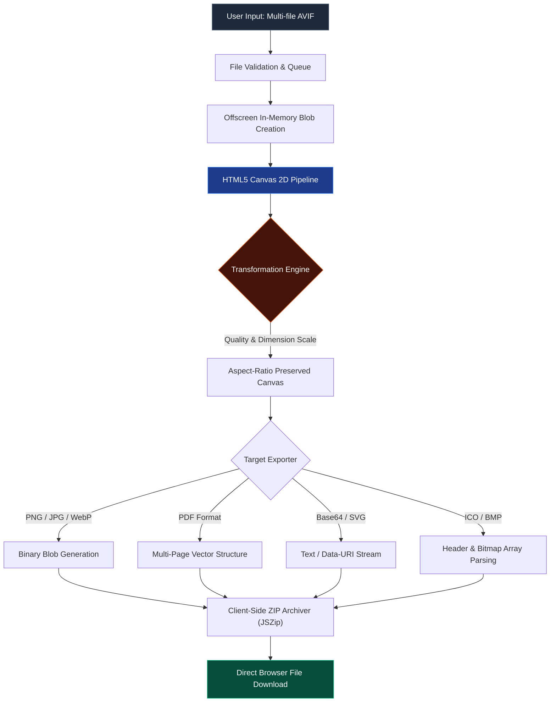

<div align="center">

# ⚡ SPManchester AVIF Suite
### Enterprise-Grade, 100% Client-Side, Privacy-First Image Conversion Engine

[](LICENSE)
[](https://www.spmanchester.com)
[](https://www.spmanchester.com)
[](#-zero-server-exfiltration-guarantee)
[](#-quick-start--deployment)
[](CONTRIBUTING.md)

<p align="center">
  <strong>High-Throughput Batch AVIF Conversion Suite for Modern Web, Cloud, and Design Workflows.</strong><br>
  Zero server uploads · Zero API quotas · Zero dependencies · 100% offline-ready.
</p>

<p align="center">
  <a href="#-live-demo--hub">Live Demo</a> •
  <a href="#-supported-converters">Supported Converters</a> •
  <a href="#-architecture">Architecture</a> •
  <a href="#-key-features">Key Features</a> •
  <a href="#-tech-stack">Tech Stack</a> •
  <a href="#-quick-start--deployment">Quick Start</a> •
  <a href="#-about-spmanchester-private-limited">About SPManchester</a>
</p>

---

</div>

## 🏢 Built with ❤️ by SPManchester Private Limited

**SPManchester AVIF Suite** is an open-source initiative designed, engineered, and maintained by **[SPManchester Private Limited](https://www.spmanchester.com)** under the technical leadership of **Sayed Mudassar Akbar**. 

As part of our mission to deliver high-performance enterprise web architectures and secure client-side computing utilities, this suite eliminates data compliance headaches (GDPR/HIPAA/SOC2) associated with sending proprietary user images to third-party cloud conversion APIs.

---

## 🎯 Problem Statement & The SPManchester Solution

### The Challenge
Modern web applications increasingly adopt **AVIF (AV1 Image File Format)** due to its superior compression algorithms (up to 50% smaller than JPEG and 20% smaller than WebP). However:
- Legacy graphic software, email clients, social previewers, and older mobile operating systems fail to render AVIF natively.
- Commercial online image converters require users to upload confidential images to remote cloud servers, creating critical **data privacy risks**, high latency, and restrictive monthly subscription paywalls.

### The Solution: SPManchester AVIF Suite
- **100% Client-Side Computing**: Converts images directly within the user's browser runtime using HTML5 Canvas and native Web APIs.
- **Zero Server Uploads**: Binary payloads never cross external network boundaries.
- **Micro-App Modularity**: Distributed as 8 independent, zero-dependency progressive micro-applications, alongside an enterprise hub portal.

---

## 🚀 Live Demo & Hub

| Resource | Link | Status |
| :--- | :--- | :--- |
| **Official Central Portal** | `https://serviceprovidermanchester.github.io/AVIF-Image-Converters/` | Active |
| **Company Website** | [https://www.spmanchester.com](https://www.spmanchester.com) | Production |
| **Enterprise Support** | [info@spmanchester.com](mailto:info@spmanchester.com) | 24/7 Response |

---

## 📦 Supported Converters

Each converter in this suite is fully self-contained with its own responsive UI, batch processor, resizing matrix, and export manager:

```
┌────────────────────────────────────────────────────────────────────────┐
│                        SPManchester AVIF Suite                         │
└────────────────────────────────────┬───────────────────────────────────┘
                                     │
    ┌──────────────┬─────────────────┼────────────────┬──────────────┐
    ▼              ▼                 ▼                ▼              ▼
[ AVIF → PNG ] [ AVIF → JPG ]    [ AVIF → WebP ]  [ AVIF → PDF ] [ AVIF → SVG ]
    │              │                 │                │              │
    └──────────────┴─────────────────┼────────────────┴──────────────┘
                                     │
                    ┌────────────────┴────────────────┐
                    ▼                                 ▼
              [ AVIF → ICO ]                    [ AVIF → BMP ]
                    │                                 │
                    └────────────────┬────────────────┘
                                     ▼
                              [ AVIF → Base64 ]
```

| Converter | Destination Format | Ideal Enterprise Use Case | Directory Link | Standalone Package |
| :--- | :--- | :--- | :--- | :--- |
| **AVIF to PNG** | `.png` | Alpha-channel transparency, UI components, vector mocks | [`avif-to-png/`](./avif-to-png/) | [`zips/avif-to-png.zip`](./zips/avif-to-png.zip) |
| **AVIF to JPG** | `.jpg` / `.jpeg` | Legacy hardware, print media, universal CMS compatibility | [`avif-to-jpg/`](./avif-to-jpg/) | [`zips/avif-to-jpg.zip`](./zips/avif-to-jpg.zip) |
| **AVIF to WebP** | `.webp` | High-efficiency web assets optimized for Google Core Web Vitals | [`avif-to-webp/`](./avif-to-webp/) | [`zips/avif-to-webp.zip`](./zips/avif-to-webp.zip) |
| **AVIF to PDF** | `.pdf` | Multi-image documents, legal dossiers, invoice archives | [`avif-to-pdf/`](./avif-to-pdf/) | [`zips/avif-to-pdf.zip`](./zips/avif-to-pdf.zip) |
| **AVIF to SVG** | `.svg` | Inline XML wrapping for responsive vector layouts | [`avif-to-svg/`](./avif-to-svg/) | [`zips/avif-to-svg.zip`](./zips/avif-to-svg.zip) |
| **AVIF to ICO** | `.ico` | Desktop icons, multi-resolution browser favicons | [`avif-to-ico/`](./avif-to-ico/) | [`zips/avif-to-ico.zip`](./zips/avif-to-ico.zip) |
| **AVIF to BMP** | `.bmp` | Embedded firmware, industrial imaging, legacy Windows apps | [`avif-to-bmp/`](./avif-to-bmp/) | [`zips/avif-to-bmp.zip`](./zips/avif-to-bmp.zip) |
| **AVIF to Base64** | Data URI / CSS | Inline stylesheets, email HTML templates, single-file bundles | [`avif-to-base64/`](./avif-to-base64/) | [`zips/avif-to-base64.zip`](./zips/avif-to-base64.zip) |

---

## 🏛️ Architecture & Processing Pipeline



---

## 🌟 Key Features

- 🔒 **Zero Server Exfiltration**: Complete privacy. Images never leave your workstation.
- ⚡ **High-Throughput Batch Processing**: Convert dozens of high-res images in seconds.
- 📐 **Smart Aspect-Ratio Resizing**: Scale width or height with automated proportional recalculation.
- 🎛️ **Granular Quality Controls**: Fine-tune compression trade-offs between file size and visual fidelity.
- 📦 **Automated ZIP Bundling**: Download single files or compile conversions into a timestamped `.zip` archive.
- 📱 **Mobile & Desktop Responsive**: Optimized touch and drag-and-drop targets for all screen sizes.
- 🚀 **Zero Build Step**: Native ES6+ JavaScript. No `npm`, `webpack`, or Node.js runtime required.

---

## 💻 Tech Stack

| Layer | Technology | Engineering Rationale |
| :--- | :--- | :--- |
| **Core Engine** | HTML5 Canvas 2D API | Hardware-accelerated client-side pixel manipulation |
| **Binary Stream** | Web Blob & File API | High-performance memory buffers with zero disk I/O |
| **Interface** | Semantic HTML5 & Modern CSS3 | Custom CSS variables, responsive grid, zero external CSS dependencies |
| **Packaging** | JSZip (Client-Side) | In-memory archive creation without network roundtrips |
| **Containerization** | Docker & Alpine Nginx | Ultra-lightweight production server container (< 25MB) |
| **CI/CD** | GitHub Actions | Automated linting, structure validation, and Pages deployment |

---

## 🛠️ Quick Start & Deployment

### 1. Run Locally (Zero Installation)

Simply clone the repository and serve it using any lightweight static server:

```bash
# Clone the repository
git clone https://github.com/serviceprovidermanchester/AVIF-Image-Converters.git
cd AVIF-Image-Converters

# Option A: Python 3
python -m http.server 8080

# Option B: Node.js (npx)
npx serve .

# Option C: PHP
php -S localhost:8080
```
Open `http://localhost:8080` in your browser.

---

### 2. Docker Deployment

Deploy the entire suite within an isolated, enterprise-hardened Alpine Nginx container:

```bash
# Build and run with Docker Compose
docker compose up -d

# Or build directly with Docker
docker build -t spmanchester/avif-suite .
docker run -d -p 8080:80 --name spmanchester-avif spmanchester/avif-suite
```
Access the dashboard at `http://localhost:8080`.

---

### 3. Deploy to GitHub Pages in 60 Seconds

1. Fork or push this repository to your GitHub organization.
2. In your repository, navigate to **Settings** → **Pages**.
3. Under **Build and deployment**:
   - **Source**: Select `Deploy from a branch` (or enable GitHub Actions).
   - **Branch**: Select `main` and folder `/(root)`.
4. Click **Save**. GitHub Pages will publish your branded suite instantly!

---

## 📂 Repository Directory Layout

```text
├── .github/
│   ├── ISSUE_TEMPLATE/
│   │   ├── bug_report.md             # Standardized bug triage
│   │   └── feature_request.md        # Feature request template
│   ├── workflows/
│   │   ├── ci.yml                    # Automated code & asset validation
│   │   └── deploy.yml                # Automatic GitHub Pages publishing
│   └── PULL_REQUEST_TEMPLATE.md      # Enterprise PR checklist
├── avif-to-base64/                   # AVIF → Base64 converter micro-app
├── avif-to-bmp/                      # AVIF → BMP converter micro-app
├── avif-to-ico/                      # AVIF → ICO converter micro-app
├── avif-to-jpg/                      # AVIF → JPG converter micro-app
├── avif-to-pdf/                      # AVIF → PDF converter micro-app
├── avif-to-png/                      # AVIF → PNG converter micro-app
├── avif-to-svg/                      # AVIF → SVG converter micro-app
├── avif-to-webp/                     # AVIF → WebP converter micro-app
├── zips/                             # Pre-compiled standalone downloadable packages
├── .gitignore                        # Git exclusion rules
├── CODE_OF_CONDUCT.md                # Community covenant v2.1
├── CONTRIBUTING.md                   # Development & PR standards
├── docker-compose.yml                # Multi-container orchestration definition
├── Dockerfile                        # Enterprise Alpine Nginx image definition
├── index.html                        # Central Suite Launchpad / Portal
├── LICENSE                           # MIT License assigned to SPManchester Pvt Ltd
├── nginx.conf                        # Hardened Nginx web server configuration
├── README.md                         # Master documentation (this file)
├── SECURITY.md                       # Vulnerability reporting protocol
└── SUPPORT.md                        # Enterprise SLA & support information
```

---

## 🗺️ Roadmap & Future Enhancements

- [ ] **WebAssembly (WASM) Hardware Acceleration**: Integrate `libavif` compiled via Emscripten for ultra-fast multi-threaded AVIF decoding on large files.
- [ ] **ICC Color Profile Preservation**: Maintain Adobe RGB and DCI-P3 wide-gamut color profiles during conversion.
- [ ] **HDR Tone-Mapping**: Native 10-bit and 12-bit HDR to SDR tone-mapping options.
- [ ] **PWA (Progressive Web App) Manifest**: Offline desktop and mobile installation with custom service workers.
- [ ] **CLI Companion**: Optional NodeJS/Rust command-line wrapper for CI/CD automated asset pipelines.

---

## 🤝 Contributing & Community

We welcome contributions! Please read our [Contributing Guidelines](CONTRIBUTING.md) and [Code of Conduct](CODE_OF_CONDUCT.md) before submitting pull requests.

```bash
git checkout -b feat/your-feature-name
git commit -m "feat: describe your change"
git push origin feat/your-feature-name
```

---

## 🏢 About SPManchester Private Limited

**[SPManchester Private Limited](https://www.spmanchester.com)** is a premier software engineering firm delivering custom enterprise software, advanced cloud architectures, artificial intelligence integrations, and high-performance web applications.

### Our Core Solutions:
- **Custom Enterprise Software**: Scalable backend architectures, distributed microservices, and bespoke SaaS platforms.
- **Client-Side High Performance Computing**: In-browser media engines, WebAssembly implementations, and data-sovereign web utilities.
- **Cloud Infrastructure & DevOps**: Kubernetes orchestration, automated CI/CD pipelines, and zero-trust cloud security.
- **Enterprise Support & Consulting**: Custom feature engineering, dedicated SLAs, and technology modernization.

### Connect With Us:
- 🌐 **Official Website**: [www.spmanchester.com](https://www.spmanchester.com)
- 👤 **Author & Lead Architect**: Sayed Mudassar Akbar
- 📧 **Enterprise Inquiries**: [info@spmanchester.com](mailto:info@spmanchester.com)
- 📍 **Headquarters**: SPManchester Private Limited

---

## 📄 License & Legal Notice

This software is licensed under the **[MIT License](LICENSE)**.

```text
Copyright (c) 2026 SPManchester Private Limited
Author: Sayed Mudassar Akbar
Website: https://www.spmanchester.com
Contact: info@spmanchester.com
```

---

<div align="center">

**⭐ If this suite saves you time and protects your data privacy, please star this repository! ⭐**

*Engineered with precision by [SPManchester Private Limited](https://www.spmanchester.com)*

</div>
